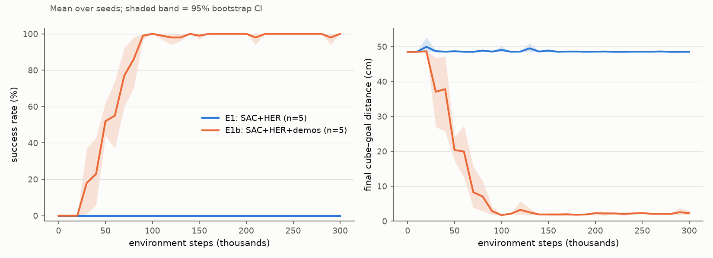
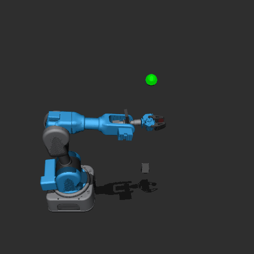
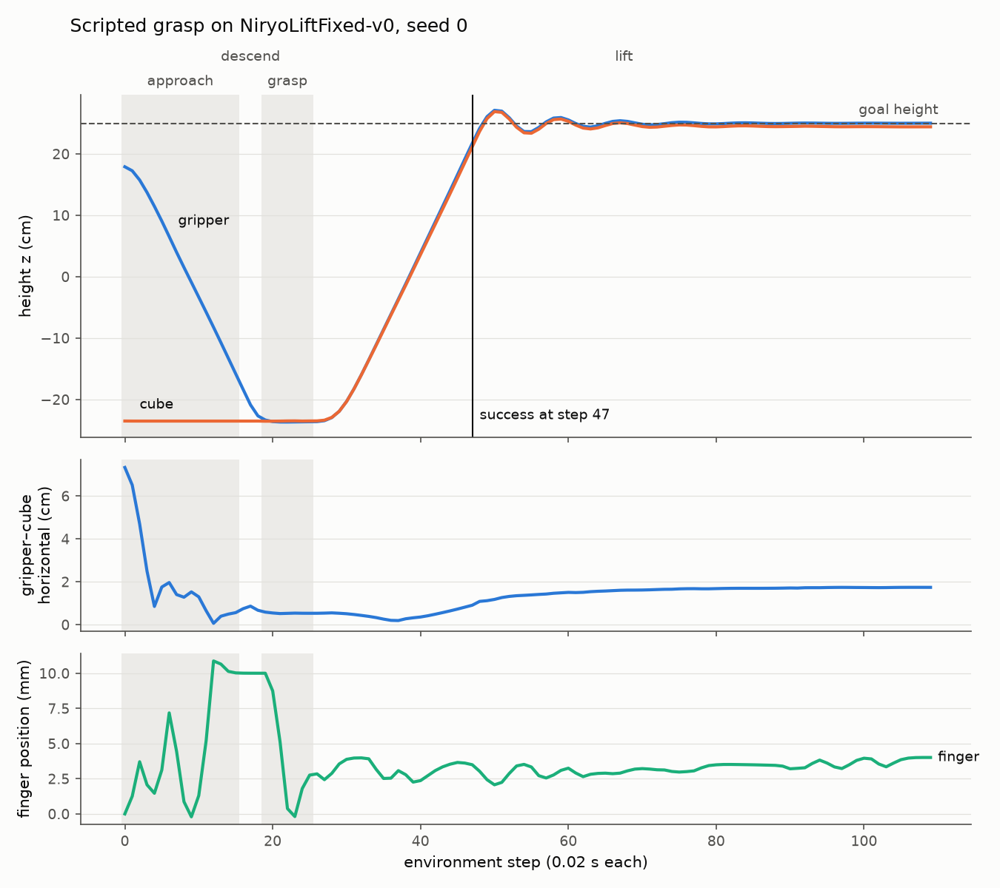

# niryo-lift-rl

**Why reinforcement learning could not lift a cube — diagnosing a MuJoCo manipulation task and
solving it with SAC + HER + scripted demonstrations.**

In a course project, PPO and SAC reached 100% on reaching with a simulated Niryo NED2 arm but
**0% on lifting a cube**. This repository traces that failure to its causes — two simulator bugs,
several task-design problems and a contact-physics issue — fixes them with measured, ablated
changes, and shows that the remaining bottleneck is exploration:

| Experiment (5 seeds, 300k steps each) | Final success (95% CI) | Final cube–goal distance | Seeds reaching 90% | Steps to 90% (median) |
|---|---|---|---|---|
| E1: SAC + HER | **0%** [0%, 0%] | 48.5 cm (cube never lifted) | 0/5 | – |
| E1b: SAC + HER + 96 scripted demonstrations | **100%** [99%, 100%] | 2.2 cm | 5/5 | 70k |

E1 and E1b differ only in whether scripted demonstrations are added to the replay buffer before
training.





---

## Contents

- [niryo-lift-rl](#niryo-lift-rl)
  - [Contents](#contents)
  - [1. Starting point](#1-starting-point)
  - [2. Diagnosis: why lifting was impossible](#2-diagnosis-why-lifting-was-impossible)
    - [Bugs in upstream niryo-gym (fixed in a fork, each with a regression test)](#bugs-in-upstream-niryo-gym-fixed-in-a-fork-each-with-a-regression-test)
    - [Task-design problems (fixed as parameters in this repo)](#task-design-problems-fixed-as-parameters-in-this-repo)
    - [H2: the real cause was single-point contact, not friction](#h2-the-real-cause-was-single-point-contact-not-friction)
  - [3. A scripted controller decides the task, before any RL](#3-a-scripted-controller-decides-the-task-before-any-rl)
  - [4. RL experiments](#4-rl-experiments)
  - [5. Limitations and open questions](#5-limitations-and-open-questions)
  - [6. Reproducing the results](#6-reproducing-the-results)
  - [7. Repository structure](#7-repository-structure)
  - [8. Acknowledgements](#8-acknowledgements)

---

## 1. Starting point

Environment: [niryo-gym](https://github.com/m-zorn/niryo-gym) (MuJoCo + Gymnasium, Niryo NED2,
MIT licence). In the course project, dense rewards with a grasp bonus, joint and mocap control,
a fixed-position curriculum and tuning friction and mass all left Lift at 0%: the cube could be
grasped but not lifted; more friction lifted it slightly.

Two hypotheses:

- **H1 (reward):** the grasp bonus creates a local optimum ("hold the cube and collect reward").
- **H2 (physics):** the contact physics does not allow lifting at all.

Approach: test the environment itself before training anything — unit tests for suspected bugs,
measurements instead of guesses, and a hand-written controller to check whether lifting is
physically possible.

## 2. Diagnosis: why lifting was impossible

### Bugs in upstream niryo-gym (fixed in a fork, each with a regression test)

| Bug | Effect | Test |
|---|---|---|
| In mocap mode, `_set_mocap` overwrites the action array before reading the gripper command, which therefore is always 0 | **The gripper can never open or close** | sends ±1 and checks the finger actuator controls |
| MJCF references `*.stl`, files are named `*.STL` | Models fail to load on case-sensitive file systems (Linux) | compares referenced names with `os.listdir` |

MuJoCo ≥ 3.12 also breaks a joint-type check in the environment; versions are pinned (mujoco 3.3.7).

### Task-design problems (fixed as parameters in this repo)

| Problem | Measurement |
|---|---|
| Most cubes are out of reach | Grip site reaches ≈0.56 m from the base; ≈30% of Lift spawns and ≈1% of PickAndPlace spawns are reachable (500 resets) |
| Cube spawns in mid-air | Falls at a terminal velocity of 0.49 m/s (damping 0.1 on a 5 g cube) and needs 29 of the 50 steps to settle |
| Gripper is very slow | Finger armature 10 with a 1 N actuator: ≈25 steps to open or close (Fetch: 2–3) |

### H2: the real cause was single-point contact, not friction

With MuJoCo's default collision pipeline, the mesh fingers and the box get **one contact point
per finger**, located at the cube's corners: general convex collision (MPR, GJK/EPA) returns a
single point, and meshes collide as their convex hulls. The fingers sank up to 21.8 mm into the
3 cm cube and squeezed it out. Enabling MuJoCo's `multiccd` flag (several contact points per
pair) fixes this:

| Setting (armature 1, 5 g cube, 10 seeds) | Contact points during grasp | Max. penetration | Scripted success |
|---|---|---|---|
| default | 2 | 21.8 mm | 0/10 |
| `multiccd` enabled | 8 | 5.7 mm | 8/10 |

Supporting evidence: **raising the finger force made things worse** (1 N → 5 N / 10 N dropped
every configuration to 0%) — squeezing harder pushed the fingers deeper and ejected the cube
faster. This also explains the course-project observation that more friction helped only a little.

## 3. A scripted controller decides the task, before any RL

`niryo_lift/controllers/scripted.py` is a four-phase state machine
(approach → descend → grasp → lift). Its parameters were measured, not guessed — for example,
the slot between the fingers spans [−2.4 cm, +1.2 cm] around the grip site, so the grip site is
placed 5 mm ahead of the cube centre.



Every fix is a constructor argument of `NiryoLiftVariant` whose **default reproduces the original
environment** (checked by a test), so each fix can be ablated on its own. Ablation with the
scripted controller (cube spawn already fixed; 50 seeds, up to 200 steps):

| Setting | Success ≤ 50 steps | Success ≤ 200 steps | Steps to success (median / p90) |
|---|---|---|---|
| reachable, at-rest spawn (baseline) | 0% | 0% | – |
| + armature 1 only | 0% | 0% | – |
| + `multiccd` | 0% | 22% | 76 / 113 |
| + `multiccd` + armature 1 | 6% | 80% | 63 / 76 |
| **+ `multiccd` + armature 0.1** | 36% | **100%** | **55 / 66** |

The final task `NiryoLiftFixed-v0` was fixed **before any RL training**, so it is not tuned to
favour an algorithm:

| | Original `NiryoLift-v1` | `NiryoLiftFixed-v0` |
|---|---|---|
| Cube spawn | centre (0.3, 0), ±0.15, in mid-air | centre (0, 0), ±0.15, at rest on the floor |
| `multiccd` | off | on |
| Finger armature | 10 | 0.1 |
| Episode length | 50 steps | 110 steps (2 × scripted median) |
| Unchanged | robot, mocap control, 25-dim observation, sparse reward (5 cm), goal ≈48.5 cm above the cube, cube mass and damping, finger force, 0.02 s per step | |

## 4. RL experiments

**Protocol.** SAC + HER (Stable-Baselines3 2.9.2), sparse reward, `gamma=0.95`,
`learning_rate=1e-3`, `batch_size=256`, `net_arch=[256, 256]`, 300k environment steps, 5 seeds
per configuration. Hyperparameters follow rl-baselines3-zoo's FetchReach entry and were first
validated on FetchReach (100% within ~10k steps). Evaluation every 10k steps on a separate
environment: deterministic policy, the same 20 held-out episodes at every checkpoint, success read
at the **last** step. Final performance = mean of the last 5 evaluations per seed; confidence
intervals are bootstrapped over seeds. Each run records the git commit of both repositories,
package versions and its config. Runs used a Slurm job array on CPU nodes (≈55 min per run).

**E1 — SAC + HER fails because it never explores lifting.** All 5 seeds stay at 0%; in evaluation
the policy never touches the cube. With random actions, the cube moved more than 1 cm in 8 of 200
episodes and was lifted more than 2 cm in 1. HER relabels goals with positions the cube actually
reached, which are almost all on the floor, while every real goal is in the air — so leaving the
cube alone is what the relabelled data rewards.

**E1b — demonstrations supply the missing experience.** 100 scripted episodes (96 successful,
10,560 transitions) are added to the replay buffer before training; they do not count as
environment steps. In these demonstrations the cube is more than 2 cm above the floor in 62% of
transitions, and in a sampled HER batch 92% of goals are in the air and 52% of rewards are
successes. All 5 seeds learn the task; they take off between 30k and 80k steps and stay at
98–100% after 100k steps.

## 5. Limitations and open questions

- **5 seeds.** With so few seeds the bootstrap interval understates uncertainty; "5/5 seeds reach
  90%" is the more robust statement.
- **Imitation or improvement?** The demonstrations come from a controller that already succeeds
  100% of the time. Whether the learned policy improves on it (for example, needs fewer steps per
  episode) is not yet analysed.
- **The task was modified.** Results on `NiryoLiftFixed-v0` are not comparable to the original
  environment; every change is listed above and can be switched off.
- **`multiccd` is global.** It changes all convex–convex collisions, not only finger–cube; other
  effects were not examined.
- **Reach estimate.** The ≈0.56 m reach was measured straight ahead and assumed for all directions.
- **In progress:** H1 (dense reward with a grasp bonus) and a PPO comparison.

## 6. Reproducing the results

Requires Python 3.12 and [uv](https://docs.astral.sh/uv/). The environment fork must sit next to
this repository:

```bash
git clone https://github.com/XWTX42/niryo-gym.git      # fork with the two bug fixes
git clone https://github.com/XWTX42/niryo-lift-rl.git
cd niryo-lift-rl
uv sync                                                    # exact versions from uv.lock
uv run pytest tests ../niryo-gym/tests                     # environment, controller, pipeline
```

```bash
# Scripted-controller ablation (section 3)
uv run python scripts/eval_scripted.py

# Demonstrations, then E1 and E1b with 5 seeds each
uv run python scripts/generate_demos.py --episodes 100
uv run python scripts/run_seeds.py configs/niryo_lift_fixed_sac_her.yaml \
    configs/niryo_lift_fixed_sac_her_demos.yaml --seeds 0 1 2 3 4 --jobs 2
#   ...or on a Slurm cluster: sbatch slurm/train_array.sbatch

# Figure and table (section 4)
uv run python scripts/aggregate.py niryo_lift_fixed_sac_her niryo_lift_fixed_sac_her_demos \
    --labels "E1: SAC+HER" "E1b: SAC+HER+demos" --name e1_vs_e1b

# Watch a trained policy, or record a GIF
uv run python scripts/watch_policy.py runs/niryo_lift_fixed_sac_her_demos/seed0
uv run python scripts/watch_policy.py runs/niryo_lift_fixed_sac_her_demos/seed0 \
    --gif results/figures/e1b_seed0.gif
```

## 7. Repository structure

```
src/niryo_lift/
├── envs/variants.py         NiryoLiftVariant: every fix is a parameter, defaults = original
├── envs/__init__.py         registers NiryoLiftReachable-v0 and NiryoLiftFixed-v0
├── controllers/scripted.py  four-phase scripted grasp controller
└── rl/                      training: env creation, evaluation, demonstrations, run bookkeeping
configs/                     one YAML file per experiment
scripts/                     entry points: train, multi-seed runs, aggregation, demos, analysis
slurm/train_array.sbatch     Slurm job array: configs × seeds
tests/                       environment variants, scripted controller, demos, training pipeline
results/                     curated figures and tables
docs/notes.md                experiment log: what was tried, why, and what happened
```

## 8. Acknowledgements

- [niryo-gym](https://github.com/m-zorn/niryo-gym) by M. Zorn (MIT licence) — the environment;
  bug fixes are in a fork.
- [Stable-Baselines3](https://github.com/DLR-RM/stable-baselines3) for SAC and HER;
  hyperparameters from [rl-baselines3-zoo](https://github.com/DLR-RM/rl-baselines3-zoo).
- [Gymnasium-Robotics](https://github.com/Farama-Foundation/Gymnasium-Robotics) (FetchReach smoke test).
- [MuJoCo documentation](https://mujoco.readthedocs.io/en/latest/computation/) on convex collision
  and `multiccd`.

Licence: MIT (see `LICENSE`).
